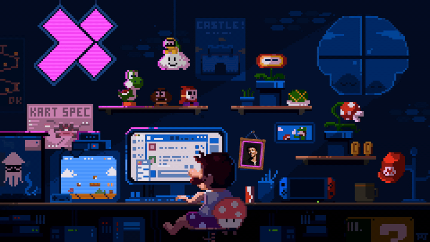
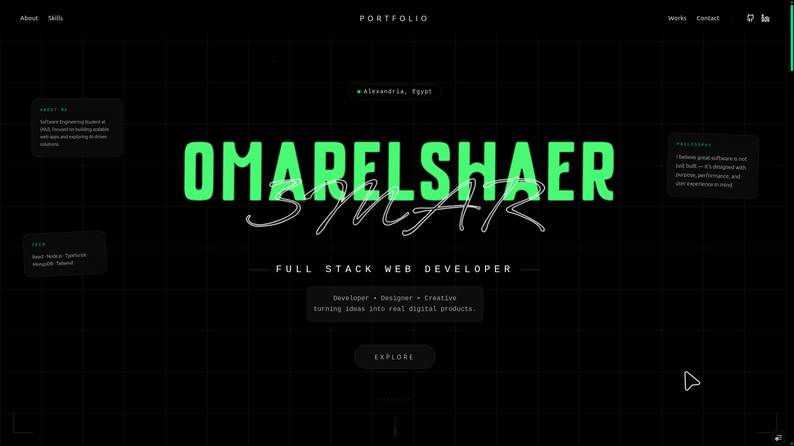

<!-- Holographic Header with Particles -->

<!-- Animated Matrix Rain Effect Banner -->
<picture>
  <source media="(prefers-color-scheme: dark)" srcset="assets/projects/gifwithme.gif">
  
</picture>

  

<!-- Cyber Typing Effect with Multiple Lines -->

<!-- Futuristic Social Badges -->

  
  
  

<!-- Live Visitor Counter with Gradient -->

<!-- Bio Section with Glassmorphism Effect -->

##  WHO AM I?

## 🌐 PORTFOLIO WEBSITE

  

  

**Crafting Clean Code, Pixel by Pixel** ❤️
 
**by Omar Elshaer**

Last Updated: January 2026 | Built with passion for Web Development & Community Leadership

 

<!-- Final Wave Footer -->

